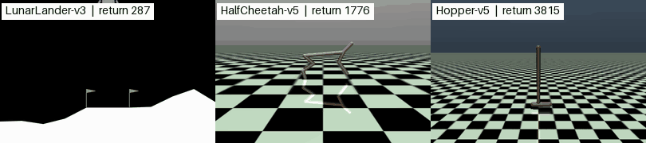
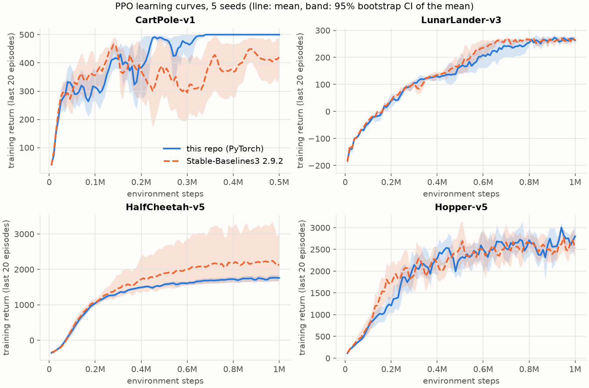
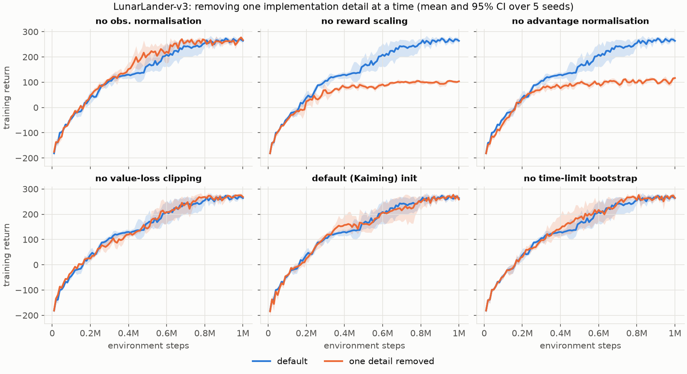
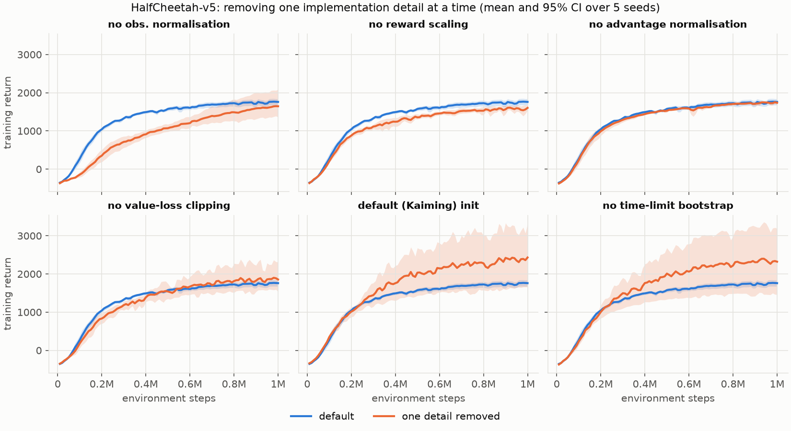

# ppo-from-scratch

Proximal Policy Optimization with GAE in plain PyTorch, following the implementation details of Huang et al. (2022), with multi-seed results, ablations and a Stable-Baselines3 baseline.

[](https://github.com/Jai-Advitheeya-Lella/ppo-from-scratch/actions/workflows/tests.yml)



*Deterministic rollouts of the seed-1 checkpoints (one episode each, return in the caption).*

This is a from-scratch reimplementation written for learning and research. The algorithm (rollout collection, GAE, clipped surrogate, value clipping, normalisers, categorical and Gaussian policies) is implemented here with tensor operations; Gymnasium provides the environments and Stable-Baselines3 is used only as a reference baseline.

## Highlights

- **Discrete and continuous actions.** Categorical policy and diagonal-Gaussian policy (state-independent learned log-std), both written from tensor ops and unit-tested against `torch.distributions`.
- **The details that matter.** Vectorized envs, orthogonal init, Adam `eps=1e-5`, linear LR annealing, per-minibatch advantage normalisation, clipped value loss, entropy bonus, global gradient clipping, running observation normalisation and discounted-return reward scaling, and bootstrapping through time-limit truncations.
- **Tested.** 44 tests: GAE against a direct sum-of-TD-residuals reference, log-probs/entropy against `torch.distributions`, the running-statistics update against batch statistics, the PPO loss in closed form, and CartPole/Pendulum learning smoke tests.
- **Measured, not claimed.** 105 training runs: 4 environments x 5 seeds for this implementation and for SB3, plus 6 single-detail ablations on two environments and one interaction experiment, all on CPU.
- **Honest ablations.** Exact permutation tests on 5 seeds. Some of the folklore details have a large effect (reward scaling, advantage normalisation on LunarLander); others show no detectable effect here.

## Results

All numbers below come from runs on this machine (CPU only, 1 thread per run, 2 runs in parallel; no GPU is used). "Eval return" is the mean over 20 deterministic episodes (policy mode, frozen normaliser statistics) of the final checkpoint; the table reports the mean ± sample standard deviation across 5 seeds (seeds 1-5). Training time is the mean wall-clock per run on a shared, heavily loaded 24-core machine, so treat it as an upper bound.

### Main environments

| Environment | Steps | Ours (final eval return) | SB3 PPO (final eval return) | Ours train time / run |
|---|---|---|---|---|
| CartPole-v1 | 500k | 500 ± 0 | 445 ± 71 | 0.6 min |
| LunarLander-v3 | 1000k | 272 ± 8 | 272 ± 3 | 1.8 min |
| HalfCheetah-v5 | 1000k | 1856 ± 139 | 2404 ± 1314 | 6.7 min |
| Hopper-v5 | 1000k | 3321 ± 505 | 3054 ± 619 | 5.5 min |



Per-seed final evaluation returns (20 deterministic episodes each):

- CartPole-v1: ours [500, 500, 500, 500, 500]; SB3 [500, 371, 490, 363, 500]
- LunarLander-v3: ours [260, 276, 279, 267, 279]; SB3 [274, 273, 268, 275, 272]
- HalfCheetah-v5: ours [1824, 1844, 1998, 1647, 1965]; SB3 [1780, 1716, 4750, 1836, 1936]
- Hopper-v5: ours [3537, 3524, 3345, 3747, 2454]; SB3 [3316, 2911, 3667, 3321, 2055]

Observations:

- **CartPole-v1** is solved (500) by all five seeds of this implementation. SB3 PPO with the same hyperparameters reaches 500 on two seeds and 363-490 on the others; I did not investigate which implementation difference causes this.
- **LunarLander-v3** is solved (training return of the last 20 episodes above 200) at 0.58M steps on average for this implementation (per seed: 0.45-0.79M) and at 0.55M for SB3, and ends at about 272 for both.
- **HalfCheetah-v5** is bimodal: most seeds settle at about 1,600-2,000 return after 1M steps, a few find a faster gait (SB3 seed 3 reaches 4,750; several ablation runs reach 3,100-4,500). With 5 seeds the SB3 mean (2,404 ± 1,314) is dominated by that one seed; the medians are close (ours 1,844, SB3 1,836). Our five default seeds all stay in the low mode. I have not compared against published numbers or tried to reproduce the high mode.
- **Hopper-v5**: 3,321 ± 505 for ours and 3,054 ± 619 for SB3 over 5 seeds each; the difference is within seed noise.

### Ablations: remove one implementation detail at a time

Each variant removes exactly one detail from the default configuration. Five seeds per cell; *p*-values are uncorrected exact permutation tests (252 relabellings), so with 5 vs 5 seeds the smallest attainable *p* is 0.008.



**LunarLander-v3** (5 seeds each; final deterministic-evaluation return, mean ± std across seeds; *p* is an exact two-sided permutation test against the default; "Train AUC" is the mean training return over the whole run, a measure of sample efficiency):

| Variant | Eval return | Δ vs default | p | Train AUC | p (AUC) | Per-seed eval |
|---|---|---|---|---|---|---|
| default | 272 ± 8 | – | – | 142 ± 18 | – | [260, 276, 279, 267, 279] |
| no obs. normalisation | 261 ± 8 | -11 | 0.063 | 156 ± 11 | 0.183 | [258, 261, 252, 264, 272] |
| no reward scaling | 174 ± 19 | -98 | 0.008 | 56 ± 2 | 0.008 | [143, 186, 192, 176, 174] |
| no advantage normalisation | 233 ± 21 | -39 | 0.008 | 62 ± 5 | 0.008 | [251, 228, 202, 232, 254] |
| no value-loss clipping | 274 ± 6 | +1 | 0.786 | 142 ± 14 | 0.905 | [279, 264, 277, 275, 273] |
| default (Kaiming) init | 270 ± 7 | -2 | 0.627 | 142 ± 23 | 1.000 | [259, 273, 273, 268, 277] |
| no time-limit bootstrap | 275 ± 2 | +3 | 0.476 | 147 ± 22 | 0.651 | [275, 278, 276, 276, 273] |
| no reward scaling *and* no value-loss clipping | 267 ± 4 | -5 | 0.230 (vs. no reward scaling alone: 0.008) | 140 ± 14 | 0.913 | [272, 262, 264, 267, 272] |

- **Reward scaling and advantage normalisation are the two details that matter on LunarLander.** Without either, the agent plateaus near 100 training return and finishes at 174 and 233 respectively (both *p* = 0.008).
- **Value-loss clipping is only harmful when rewards are unscaled.** It has no effect with reward scaling (274 vs 272), but with raw rewards the critic's targets are in the hundreds, so a clip range of 0.2 around the old prediction throttles value learning. Removing clipping *and* reward scaling together recovers 267 ± 4 (vs. 174 with clipping on, *p* = 0.008). This is the one result in this table where the effect of one detail depends on another.
- Observation normalisation, orthogonal init and time-limit bootstrapping have no detectable effect on LunarLander at this budget (all *p* > 0.05).



**HalfCheetah-v5** (5 seeds each; final deterministic-evaluation return, mean ± std across seeds; *p* is an exact two-sided permutation test against the default; "Train AUC" is the mean training return over the whole run, a measure of sample efficiency):

| Variant | Eval return | Δ vs default | p | Train AUC | p (AUC) | Per-seed eval |
|---|---|---|---|---|---|---|
| default | 1856 ± 139 | – | – | 1326 ± 41 | – | [1824, 1844, 1998, 1647, 1965] |
| no obs. normalisation | 1855 ± 526 | -1 | 1.000 | 933 ± 134 | 0.008 | [1602, 1367, 1965, 1626, 2715] |
| no reward scaling | 1756 ± 157 | -99 | 0.286 | 1160 ± 74 | 0.008 | [1810, 1931, 1839, 1530, 1672] |
| no advantage normalisation | 1851 ± 64 | -4 | 0.929 | 1294 ± 35 | 0.238 | [1949, 1841, 1819, 1779, 1866] |
| no value-loss clipping | 2060 ± 628 | +204 | 0.794 | 1306 ± 220 | 0.690 | [1873, 3167, 1839, 1826, 1595] |
| default (Kaiming) init | 2862 ± 1509 | +1007 | 0.373 | 1678 ± 623 | 0.397 | [4531, 1842, 1833, 4494, 1612] |
| no time-limit bootstrap | 2695 ± 1344 | +840 | 0.413 | 1638 ± 692 | 0.444 | [1818, 1776, 3979, 4336, 1568] |


- **Observation normalisation is a sample-efficiency detail on HalfCheetah.** The final evaluation return is the same (1,855 vs 1,856), but the mean training return over the run drops from 1,326 to 933 (*p* = 0.008): the unnormalised agent learns much more slowly, and the gap in training return narrows by 1M steps but is still visible.
- Reward scaling also lowers the area under the curve (1,160 vs 1,326, *p* = 0.008) without a significant change in final return.
- **No other HalfCheetah difference is significant.** The final-return standard deviations of the Kaiming-init and no-bootstrap variants (about 1,500 and 1,300) come from two seeds each that reached 4,000-4,500 while the rest stayed near 1,600-1,800. With a bimodal outcome and 5 seeds that is not distinguishable from chance (*p* = 0.37-0.41); more seeds would be needed to say whether either detail changes the odds of finding the faster gait.

## How it works

**Rollouts.** `num_envs` synchronous Gymnasium environments run for `num_steps` steps each, using same-step autoreset so that every buffer slot is a real transition. When an episode is cut by a time limit (`truncated` but not `terminated`) the value of the true final observation is added to the last reward, $r_t \leftarrow r_t + \gamma V(s_{T})$, so that time limits are not treated as terminal states.

**Generalised advantage estimation.** With $\delta_t = r_t + \gamma (1-d_{t}) V(s_{t+1}) - V(s_t)$,

$$\hat A_t = \sum_{l \ge 0} (\gamma\lambda)^l\, \delta_{t+l}, \qquad \hat R_t = \hat A_t + V(s_t),$$

computed with the backward recursion $\hat A_t = \delta_t + \gamma\lambda (1-d_t) \hat A_{t+1}$ (`src/ppo/gae.py`, tested against the explicit sum).

**Objective.** For each minibatch, with $\rho_t = \pi_\theta(a_t|s_t)/\pi_{\theta_\text{old}}(a_t|s_t)$ and normalised advantages,

$$L = -\mathbb{E}\big[\min(\rho_t \hat A_t,\ \operatorname{clip}(\rho_t, 1-\epsilon, 1+\epsilon)\hat A_t)\big] + c_v\, \tfrac12\mathbb{E}\big[\max\big((V_\theta - \hat R)^2,\ (V_\text{old} + \operatorname{clip}(V_\theta - V_\text{old}, -\epsilon, \epsilon) - \hat R)^2\big)\big] - c_e\, \mathbb{E}[H[\pi_\theta]].$$

The batch is split into `num_minibatches` shuffled minibatches and swept `update_epochs` times, with global gradient-norm clipping at 0.5 and a linearly annealed learning rate. KL and clip fraction (`approx_kl` is the low-variance $k_3$ estimator $(\rho-1)-\log\rho$) are logged per update.

**Policies.** The actor and critic are separate MLPs (64-64, tanh) with orthogonal init (gain $\sqrt2$ in hidden layers, 0.01 for the policy head, 1 for the value head). Discrete actions use a categorical distribution over logits. Continuous actions use $a \sim \mathcal N(\mu_\theta(s), \operatorname{diag}(e^{2\ell}))$ with a learned, state-independent log-std $\ell$ initialised to 0; the log-prob is summed over action dimensions and the sample is clipped to the action bounds only when it is sent to the environment, not when computing log-probs.

**Normalisation.** Observations are standardised with running mean/variance (Chan et al. parallel update) and clipped to $[-10, 10]$. Rewards are divided by the running standard deviation of the discounted return (no mean subtraction) and clipped to $[-10, 10]$. Evaluation uses the frozen observation statistics.

**Hyperparameters** (`src/ppo/config.py`). CartPole follows CleanRL's `ppo.py`; MuJoCo follows CleanRL's `ppo_continuous_action.py`; LunarLander uses 16 envs x 1024 steps, 256 minibatches, 4 epochs, $\gamma=0.999$, $\lambda=0.98$, lr $3\times10^{-4}$, entropy coefficient 0.01, with observation and reward normalisation. The SB3 baseline (`scripts/sb3_baseline.py`) is configured from the same preset, using `VecNormalize` for the two normalisers.

## Quickstart

```bash
uv venv --python 3.12 .venv && source .venv/bin/activate
uv pip install torch --index-url https://download.pytorch.org/whl/cpu   # or the CUDA wheel; CPU is enough
uv pip install -r requirements.txt && uv pip install -e .

pytest -q                                                    # 44 tests (a few need Box2D / MuJoCo)

python -m ppo.train --env-id CartPole-v1 --seed 1            # ~1 min
python -m ppo.train --env-id LunarLander-v3 --seed 1         # ~2 min
python -m ppo.train --env-id HalfCheetah-v5 --seed 1         # ~6 min
python -m ppo.train --env-id Hopper-v5 --seed 1 --norm-adv false   # any config field is a flag

# Everything in this README (105 runs, resumable, 2 workers):
python scripts/run_experiments.py --groups main sb3 ablation interaction --workers 2
python scripts/make_figures.py                               # figures + assets/results.md
MUJOCO_GL=egl python scripts/make_gifs.py --seed 1           # GIFs from the seed-1 checkpoints
```

Each run writes `config.json`, `episodes.csv`, `updates.csv`, `summary.json` and `model.pt` to `runs/<impl>/<env>/<variant>/seed<k>/`. The episode logs and summaries behind every figure are committed under `runs/`; checkpoints, update logs and stdout logs are not.

## Project structure

```
src/ppo/
  config.py          PPOConfig dataclass, per-environment presets, CLI flags
  distributions.py   Categorical and diagonal Gaussian (log-prob, entropy, sample, mode)
  networks.py        orthogonally initialised actor-critic MLPs
  normalization.py   running mean/std, observation normaliser, return-based reward scaler
  gae.py             generalised advantage estimation
  envs.py            vector-env construction (same-step autoreset), space inspection
  trainer.py         rollout, PPO loss, update loop, evaluation, checkpoints
  train.py           command-line entry point
scripts/
  run_experiments.py main grid, SB3 baseline, ablations (resumable)
  sb3_baseline.py    Stable-Baselines3 PPO with matched hyperparameters
  make_figures.py    learning curves, ablation figures, markdown tables
  make_gifs.py       GIF rendering of trained agents
tests/               GAE, distributions, normalisation, loss, end-to-end smoke tests
```

## Limitations

- Five seeds per configuration is enough to see large effects but not small ones, and the HalfCheetah results are bimodal; the ablation *p*-values are not corrected for multiple comparisons.
- Single-process, CPU, `SyncVectorEnv`: throughput is about 2,600 steps/s on HalfCheetah per process.
- One architecture and one set of hyperparameters per environment; no tuning was done for the ablation variants.
- No LSTM, no Atari/image observations, no multi-discrete action spaces.
- Software versions: PyTorch 2.11, Gymnasium 1.4.0, MuJoCo 4.0.1, Stable-Baselines3 2.9.2 (see `requirements.txt`).

## References

- J. Schulman, F. Wolski, P. Dhariwal, A. Radford, O. Klimov. [Proximal Policy Optimization Algorithms](https://arxiv.org/abs/1707.06347), 2017.
- J. Schulman, P. Moritz, S. Levine, M. Jordan, P. Abbeel. [High-Dimensional Continuous Control Using Generalized Advantage Estimation](https://arxiv.org/abs/1506.02438), ICLR 2016.
- S. Huang, R. F. J. Dossa, A. Raffin, A. Kanervisto, W. Wang. [The 37 Implementation Details of Proximal Policy Optimization](https://iclr-blog-track.github.io/2022/03/25/ppo-implementation-details/), ICLR Blog Track 2022.
- L. Engstrom et al. [Implementation Matters in Deep Policy Gradients: A Case Study on PPO and TRPO](https://arxiv.org/abs/2005.12729), ICLR 2020.
- F. Pardo et al. [Time Limits in Reinforcement Learning](https://arxiv.org/abs/1712.00378), ICML 2018.
- M. Andrychowicz et al. [What Matters in On-Policy Reinforcement Learning?](https://arxiv.org/abs/2006.05990), ICLR 2021.
- A. Raffin et al. [Stable-Baselines3](https://jmlr.org/papers/v22/20-1364.html), JMLR 2021 (reference baseline).
- S. Huang et al. [CleanRL](https://github.com/vwxyzjn/cleanrl), JMLR 2022: the single-file PPO there informed the choice of presets; no code was copied.
- M. Towers et al. [Gymnasium](https://github.com/Farama-Foundation/Gymnasium), 2024.

## License

MIT, see `LICENSE`.
